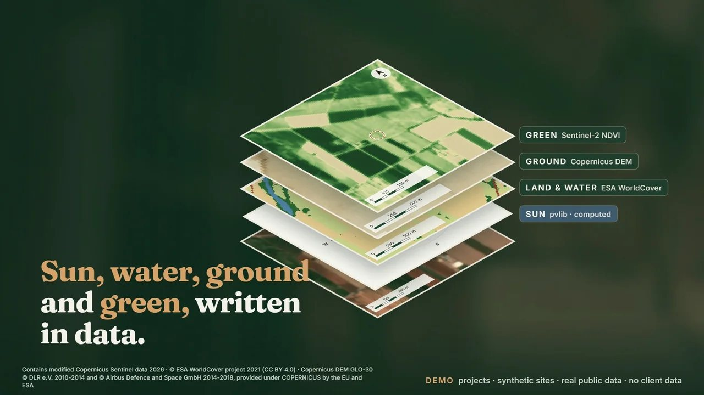
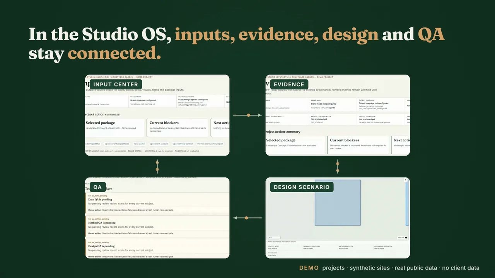
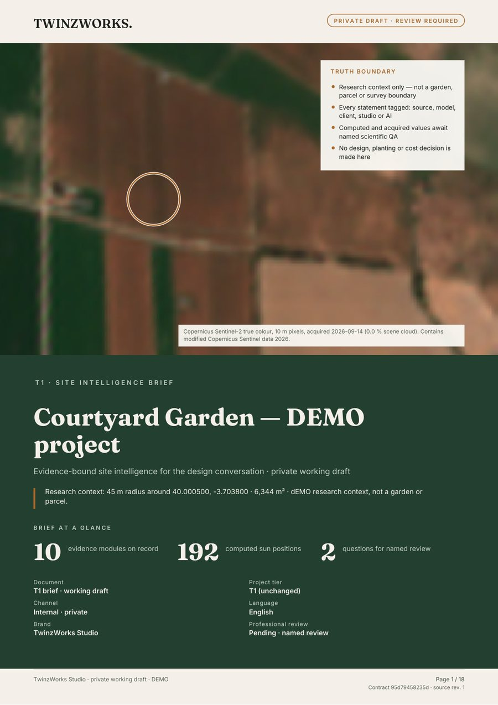
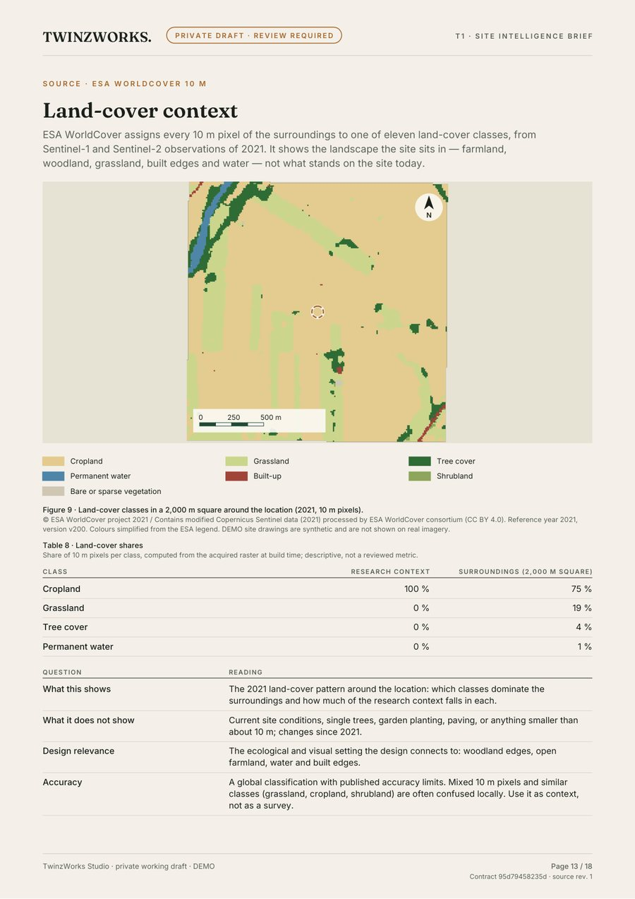
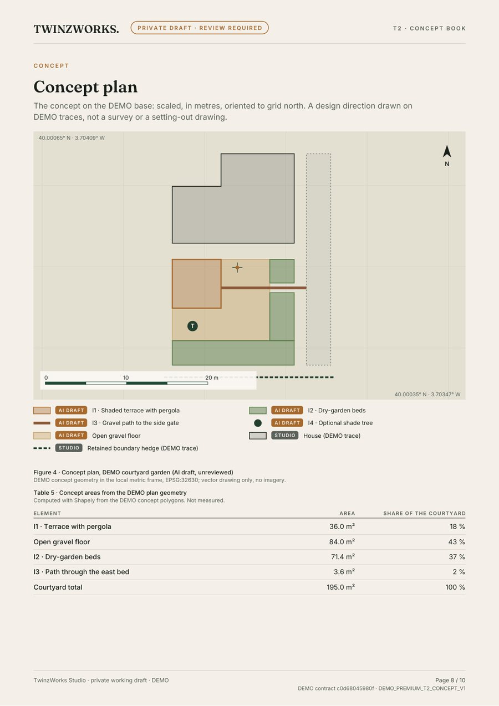
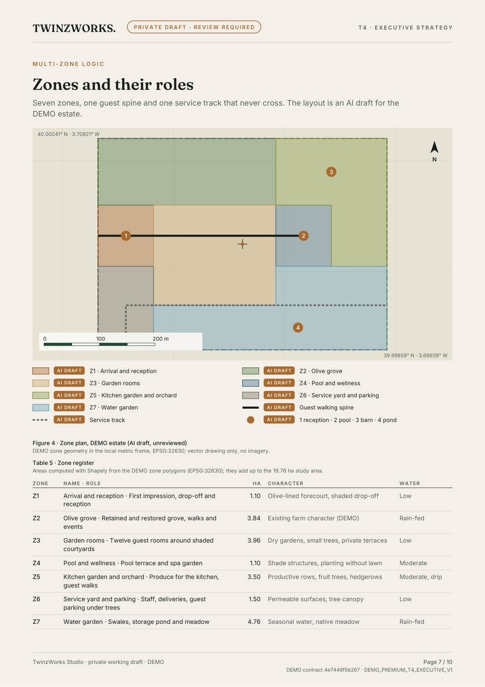
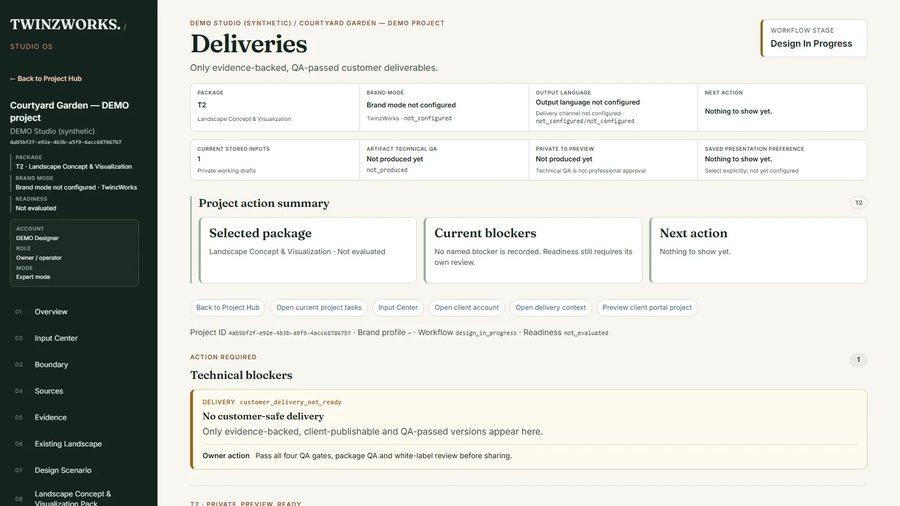

<a href="README.tr.md">Türkçe</a>

<h1 align="center">TwinzWorks</h1>

<strong>Turn your site and project files into landscape decisions you can act on.</strong>

Landscape intelligence and design delivery: AI-assisted, human-reviewed, evidence-backed. 
<a href="https://twinzworks.com/">twinzworks.com</a> · <a href="https://twinzworks.com/contact/">Discuss your project</a>

<!-- FILM:BRAND_EN -->

Brand film · 60 s · <a href="https://twinzworks.com/about/">watch on twinzworks.com</a> · narration: synthetic voice of Tuncer Timur, with his consent

## How it works

<!-- FILM:PRODUCT_EN -->

Product film · 56 s · <a href="https://twinzworks.com/how-it-works/">watch on twinzworks.com</a>

1. **You bring the question, the site and the files you already have.** These can be plans, surveys, photos and schedules.
2. **Inputs are checked before use.** Each file keeps its source. A file that cannot safely be used stays out.
3. **AI drafts fast; a named landscape architect decides.** First drafts are prepared inside Studio OS. Nothing counts as approved until the design lead reviews it.
4. **You receive coordinated deliverables.** These are PDF books, XLSX schedules and GeoPackage spatial files. Every statement keeps its source, scale and limits.

## Real pages from DEMO projects

<table>
<tr>
<td width="50%"></td>
<td width="50%"></td>
</tr>
<tr>
<td width="50%"></td>
<td width="50%"></td>
</tr>
</table>

Every page and screen comes from DEMO projects on synthetic sites, built with real public data. None contains client data.

## Three ways in

| Your goal | What you receive | First step |
|---|---|---|
| **Understand the site** | A structured site read: opportunities, constraints and what to verify next. | Ask for a readiness preview or a Site Intelligence Brief. |
| **Develop the landscape** | Coordinated concept and technical books, plans, schedules and coordination files. | Discuss a landscape concept once a reviewed base exists. |
| **Extend your studio** | Selected packages prepared under your own brand, with a private review room. | Review a partner brand profile. |

[Find your starting point →](https://twinzworks.com/find-your-start/)

## Who we are

- **Zümra Timur** is the landscape architect and design lead. Design decisions and the professional review are hers.
- **Tuncer Timur** handles systems, evidence and product: Studio OS, the data engine and delivery.

The TZ monogram carries both names.

## Where things stand

- **Available for selected projects (pre-launch):** the Site Data Readiness Preview and the Site Intelligence Brief. They are built from real public data in Studio OS. Each is reviewed by the named landscape architect before it reaches a client.
- **In development:** concept, design development and strategy books. Today they exist as DEMO specimens, like the pages above; the general production path is still being completed.
- **Partner studios:** white-label delivery by arrangement.

Current packages and prices: [twinzworks.com/services](https://twinzworks.com/services/)

---

Data credits:
Contains modified Copernicus Sentinel data 2026 ·
© ESA WorldCover project 2021 (CC BY 4.0) ·
Copernicus DEM GLO-30 © DLR e.V. 2010-2014 and © Airbus Defence and Space GmbH 2014-2018, provided under COPERNICUS by the EU and ESA ·
NASA POWER, NASA Langley Research Center POWER Project ·
sun geometry computed with pvlib.

Film narration is a synthetic voice of Tuncer Timur, used with his consent. Music was generated locally for TwinzWorks with ACE-Step 1.5 (MIT).

© TwinzWorks. The brand assets, films and page images are not licensed for reuse. This repository contains no application code.
