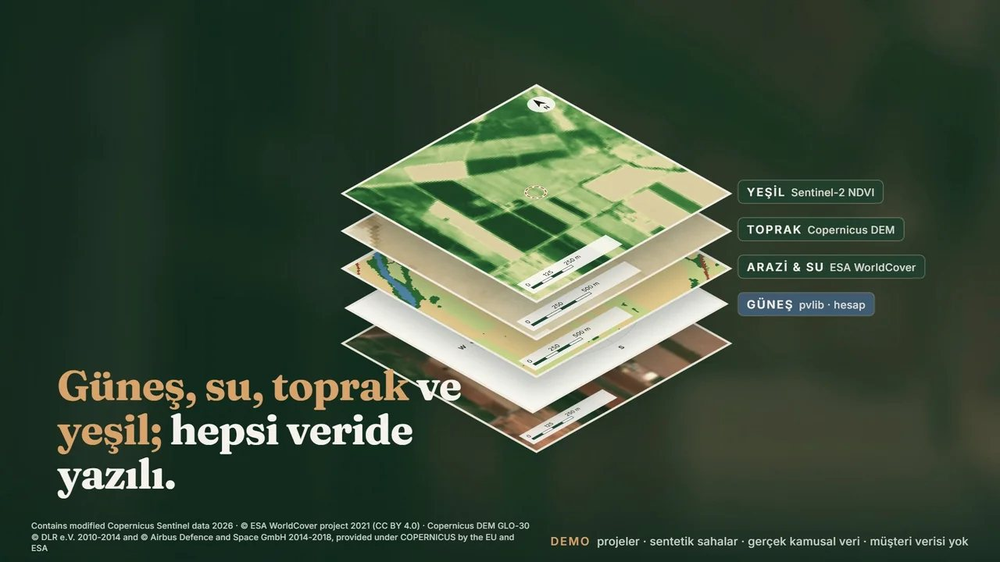
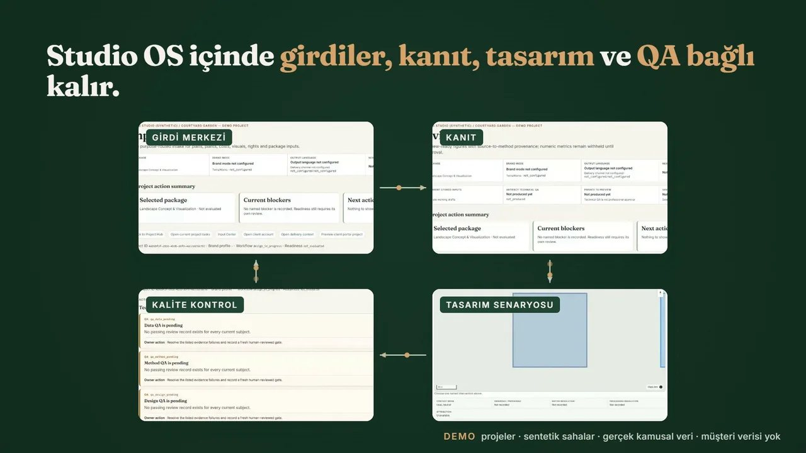
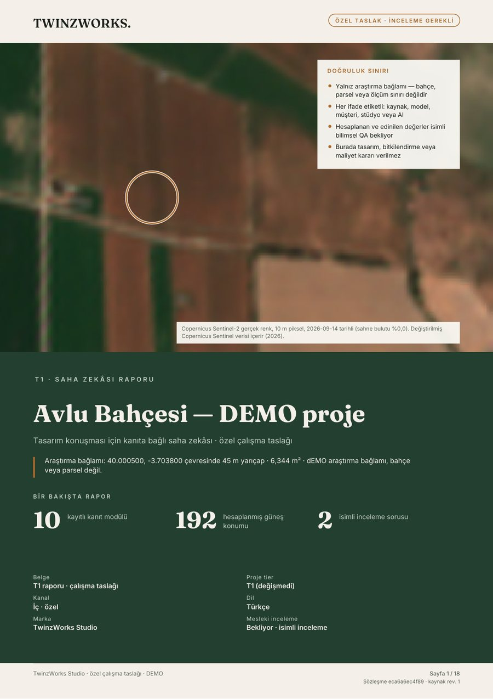
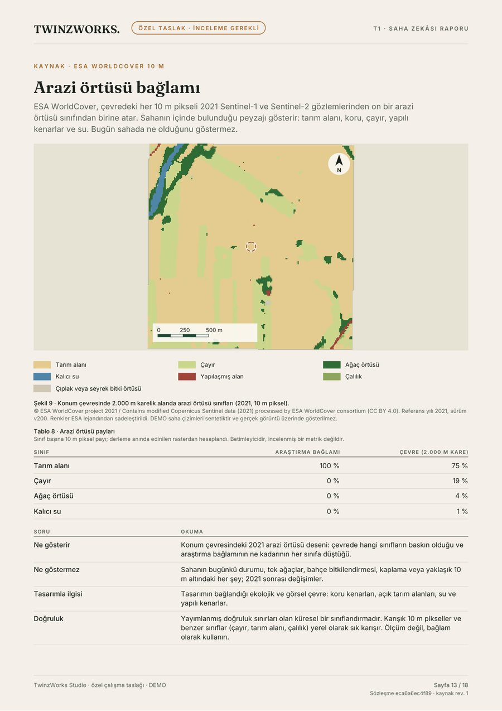
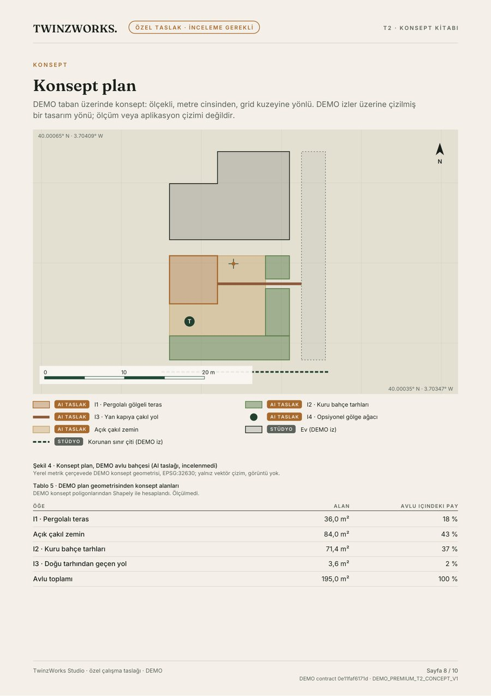
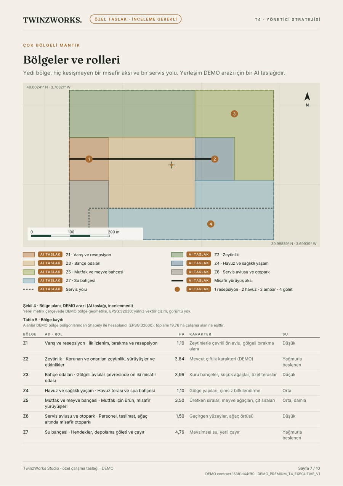
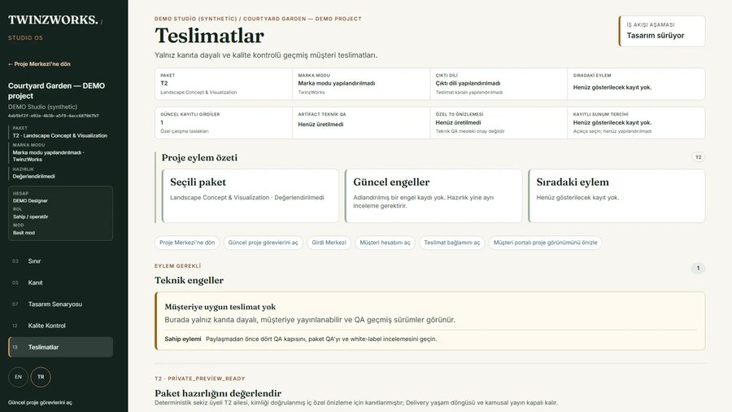

<a href="README.md">English</a>

<h1 align="center">TwinzWorks</h1>

<strong>Sahanızı ve proje dosyalarınızı uygulanabilir peyzaj kararlarına dönüştürün.</strong>

Peyzaj zekâsı ve tasarım teslimi: yapay zekâ destekli, insan tarafından incelenmiş, kanıta dayalı. 
<a href="https://twinzworks.com/tr/">twinzworks.com</a> · <a href="https://twinzworks.com/tr/contact/">Projenizi görüşelim</a>

<!-- FILM:BRAND_TR -->

Marka filmi · 56 sn · <a href="https://twinzworks.com/tr/about/">twinzworks.com'da izleyin</a> · seslendirme: Tuncer Timur'un sentetik sesi, onayıyla

## Nasıl çalışır

<!-- FILM:PRODUCT_TR -->

Ürün filmi · 56 sn · <a href="https://twinzworks.com/tr/how-it-works/">twinzworks.com'da izleyin</a>

1. **Soruyu, sahayı ve elinizdeki dosyaları siz getirirsiniz.** Bunlar plan, ölçüm, fotoğraf ve çizelge olabilir.
2. **Girdiler kullanılmadan önce kontrol edilir.** Her dosya kaynağıyla birlikte tutulur. Güvenle kullanılamayan dosya dışarıda kalır.
3. **Yapay zekâ hızlı taslak hazırlar; isimli peyzaj mimarı karar verir.** İlk taslaklar Studio OS içinde hazırlanır. Tasarım lideri incelemeden hiçbir şey onaylı sayılmaz.
4. **Koordineli teslimleri alırsınız.** Bunlar PDF kitaplar, XLSX çizelgeler ve GeoPackage mekânsal dosyalardır. Her ifade kaynağını, ölçeğini ve sınırını taşır.

## DEMO projelerden gerçek sayfalar

<table>
<tr>
<td width="50%"></td>
<td width="50%"></td>
</tr>
<tr>
<td width="50%"></td>
<td width="50%"></td>
</tr>
</table>

Tüm sayfa ve ekranlar DEMO projelerden gelir: sentetik sahalar, gerçek kamusal veri. Hiçbirinde müşteri verisi yok.

## Üç başlangıç yolu

| Hedefiniz | Ne alırsınız | İlk adım |
|---|---|---|
| **Sahayı anlamak** | Yapılandırılmış saha okuması: fırsatlar, kısıtlar ve sırada neyin doğrulanacağı. | Hazırlık önizlemesi veya Saha Zekâsı Raporu isteyin. |
| **Peyzajı geliştirmek** | Koordineli konsept ve teknik kitaplar, planlar, çizelgeler ve koordinasyon dosyaları. | İncelenmiş bir temel oluşunca peyzaj konseptini konuşalım. |
| **Stüdyonuzu büyütmek** | Seçili paketler, kendi markanızla ve özel inceleme odasıyla hazırlanır. | Bir partner marka profilini inceleyin. |

[Başlangıç noktanızı bulun →](https://twinzworks.com/tr/find-your-start/)

## Biz kimiz

- **Zümra Timur** peyzaj mimarı ve tasarım lideridir. Tasarım kararları ve mesleki inceleme ona aittir.
- **Tuncer Timur** sistemlerden, kanıttan ve üründen sorumludur: Studio OS, veri motoru ve teslim.

TZ monogramı iki ismi birlikte taşır.

## Bugünkü durum

- **Seçili projeler için hazır (lansman öncesi):** Saha Veri Hazırlık Önizlemesi ve Saha Zekâsı Raporu. İkisi de Studio OS'ta gerçek kamusal veriden üretilir. Her biri müşteriye ulaşmadan önce isimli peyzaj mimarınca incelenir.
- **Geliştiriliyor:** konsept, tasarım geliştirme ve strateji kitapları. Bugün yukarıdaki gibi DEMO örnekler olarak var; genel üretim yolu hâlâ tamamlanıyor.
- **Partner stüdyolar:** beyaz etiket teslim, anlaşmayla.

Güncel paketler ve fiyatlar: [twinzworks.com/tr/services](https://twinzworks.com/tr/services/)

---

Veri atıfları:
Contains modified Copernicus Sentinel data 2026 ·
© ESA WorldCover project 2021 (CC BY 4.0) ·
Copernicus DEM GLO-30 © DLR e.V. 2010-2014 and © Airbus Defence and Space GmbH 2014-2018, provided under COPERNICUS by the EU and ESA ·
NASA POWER, NASA Langley Research Center POWER Project ·
güneş geometrisi pvlib ile hesaplandı.

Film seslendirmesi, Tuncer Timur'un onayıyla kullanılan sentetik sesidir. Müzik, TwinzWorks için ACE-Step 1.5 (MIT) ile yerelde üretildi.

© TwinzWorks. Marka varlıkları, filmler ve sayfa görselleri yeniden kullanım için lisanslı değildir. Bu depo uygulama kodu içermez.
